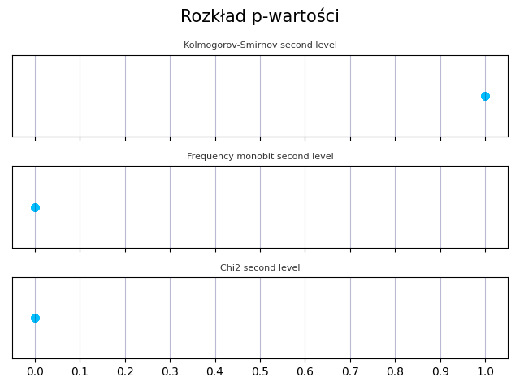
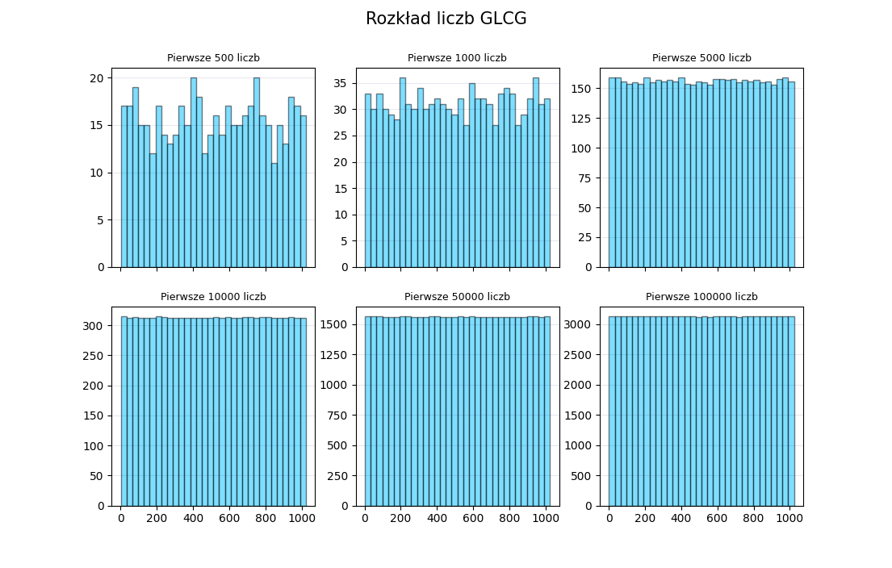

# Testing Pseudo-Random Number Generators

**Implementation of five PRNGs (LCG, generalised LCG, RC4, xorshift) and a statistical test battery with first- and second-level testing.**


Every Monte Carlo result is only as good as the random numbers behind it. This project builds several classic generators from scratch and measures how "random" their output really is. Each generator produces about 10⁶ numbers, which are then run through goodness-of-fit and randomness tests at two levels:

- **First level**: one test on the whole sequence, giving a single p-value
- **Second level**: the sequence is split into many blocks, a p-value is computed per block, and we test whether those p-values are themselves **uniform on [0, 1]**, as they must be under H₀

## Generators

| Generator | Description |
|---|---|
| `LCG(M, a, c)` | Linear congruential: `x_{n+1} = (a·x_n + c) mod M`, tested for (13, 1, 5) and (2¹⁰, 3, 7) |
| `GLCG(M, {a_i})` | Generalised LCG using k previous states, tested for (2¹⁰, {3, 7, 68}) |
| `RC4(n)` | Stream cipher used as a PRNG (KSA + PRGA), with a key derived from the system clock |
| `xorshift` | Marsaglia's 32-bit shift-register generator |

## Tests

χ² goodness-of-fit, Kolmogorov–Smirnov, poker test, frequency monobit, frequency (bucket) test and the **birthday spacings** test (Poisson-distributed statistic, with its own χ²-based second level).

## Results

First-level p-values (from the report's summary table):

| PRNG | χ² | KS | Birthday | Poker | Monobit |
|---|---|---|---|---|---|
| LCG(13, 1, 5) | 0 | 1 | 0.78 | 0 | 0 |
| LCG(2¹⁰, 3, 7) | 0 | 1 | 1 | 0 | 1 |
| GLCG(2¹⁰, {3, 7, 68}) | 0 | 1 | 1 | 0 | 0 |
| RC4(32) | 0.64 | 1 | 1 | 0 | 0.585 |
| xorshift | — | 0.99 | 1 | 0.99 | 0.86 |

**Takeaways**
- **RC4 and xorshift are a class above the linear generators.** Second-level testing confirms their quality on most tests.
- The linear generators fail decisively at the second level, where their p-values collapse onto a few points. The two LCG/GLCG parameter sets also reach only about **512 of the 1024** possible values.
- KS p-values of exactly 1 are themselves a red flag: the output is *too regular* to be random. Only second-level testing exposes this.
- The poker test is very strict for RC4. Its p-value falls from 0.92 (first 100 numbers) to 0.0002 (first 10,000).

<p align="center">
  
  
</p>
<p align="center"><em>Left: second-level p-values of LCG(13, 1, 5) are degenerate instead of uniform. Right: GLCG output histograms for growing n.</em></p>

## Repository structure

```
src/prng_tests/generators/   lcg, glcg, rc4 (+ multiple-key variant), xorshift
src/prng_tests/              metrics.py (test statistics), transforms.py (ints ↔ uniforms ↔ bits)
scripts/                     rc4_analysis, xorshift_analysis
archive/incomplete_analyses/ earlier LCG/GLCG/irrational-digits analyses
reports/                     full report (PDF, in Polish)
```

## How to run

```bash
python -m pip install -e .
python -m prng_tests.generators.xorshift --help      # likewise: lcg, glcg, rc4
python -m scripts.xorshift_analysis                   # expects data/generated/xorshift_1048576.pkl
```

Unit tests: `python -m unittest discover -s tests`. These are educational generators, not a cryptographic library. Only load pickle files that you generated yourself.

## Report

📄 [Full report (PDF, Polish, 18 pages)](reports/PRNG_Karawan_Adamek.pdf)

**Authors:** Maciej Karawan, Paulina Adamek. Introduction to Simulation and Monte Carlo Methods course project.
